# Lab 05 – Sécurité des identités avec Microsoft Entra ID (SC-300)

**English summary:** Identity and access security lab in a dedicated Microsoft Entra ID P2 tenant, aligned with the **SC-300** (Identity and Access Administrator) objectives. I built a clean lab tenant with a dedicated Global Admin and a **break-glass emergency account**, then implemented a complete identity-security stack: **Conditional Access** (require MFA, block legacy authentication, plus two **risk-based** policies driven by Identity Protection), **Privileged Identity Management (PIM)** with a full just-in-time activation cycle including **approval**, **Identity Protection** risk monitoring, and an **Access Review** to recertify privileged role eligibility. The lab moves identity from *static* protection (fixed rules) to *dynamic*, risk-aware, least-privilege-in-time governance — the Zero Trust model applied to identity.

---

## Contexte : l'identité comme nouveau périmètre

Dans le cloud, le pare-feu réseau ne suffit plus : l'**identité est le nouveau périmètre**. Un attaquant qui vole des identifiants n'a pas besoin de « percer » le réseau — il se connecte. Ce lab met en place les contrôles qui défendent cette surface : prouver qui on est (MFA), fermer les portes dérobées (auth héritée), réagir au risque en temps réel (Identity Protection), limiter les privilèges dans le temps (PIM) et recertifier périodiquement les accès (revue d'accès).

| Sigle | Sens |
|---|---|
| **MFA** | Authentification multifacteur |
| **CA** (*Conditional Access*) | Accès conditionnel : *SI* (conditions) *ALORS* (contrôle d'accès) |
| **PIM** (*Privileged Identity Management*) | Gestion des accès privilégiés — rôles à la demande, juste-à-temps |
| **JIT** (*Just-in-Time*) | Juste-à-temps : accès accordé seulement au besoin, pour un temps limité |
| **Identity Protection** | Détection du risque d'identité par IA / threat intelligence |

## Environnement

| Élément | Valeur |
|---|---|
| Tenant | Microsoft Entra ID (répertoire de test dédié) |
| Licence | **Microsoft Entra ID P2** (essai 30 jours) |
| Compte d'administration | Compte **membre interne** dédié, rôle **Administrateur général** |
| Comptes de test | 2 employés (Alice, Benoit) licenciés P2 + 1 compte **break-glass** non licencié |
| Groupe | `SG-Employes` (sécurité, membres : Alice, Benoit) |
| Portail | Centre d'administration Microsoft Entra (entra.microsoft.com) |

## Outils et concepts
Microsoft Entra ID P2 · Accès conditionnel · MFA · Identity Protection · Privileged Identity Management (PIM) · Revues d'accès · Microsoft Entra ID Governance · Security Defaults · Zero Trust · Moindre privilège

---

## 1. Préparer un environnement d'administration propre

**Problème rencontré d'entrée :** le tenant avait été créé via un abonnement Azure avec un **compte Microsoft personnel (Gmail)**. Ce compte est enregistré comme **invité/externe** dans l'annuaire, et Microsoft **n'autorise pas** un tel compte à gérer les licences et les essais M365 (bouton grisé, accès refusé au Centre M365).

**Solution (et bonne pratique SC-300) :** créer un **compte administrateur membre interne** dans le domaine `onmicrosoft.com`, lui attribuer le rôle **Administrateur général**, puis l'utiliser pour toute l'administration. C'est la bonne façon de séparer le propriétaire du tenant et l'administration opérationnelle.

Ensuite, activation de l'essai **Entra ID P2** (Centre M365 → Facturation → Acheter des services), puis assignation de la licence P2 aux comptes qui en ont besoin.

### Qui a besoin d'une licence P2 ? (point d'examen)
La licence P2 est **par utilisateur**, et on l'assigne selon le **besoin fonctionnel** :

| Le compte… | Besoin de P2 ? |
|---|---|
| Éligible à un rôle via PIM | ✅ Oui |
| Cible d'une politique Identity Protection (risque) | ✅ Oui |
| Ciblé par l'accès conditionnel (techniquement P1, inclus dans P2) | ✅ Oui (conformité) |
| Soumis à une revue d'accès | ✅ Oui |
| Existe, se connecte, ou membre d'un groupe | ❌ Non |

> **Nuance (piège d'entrevue) :** l'accès conditionnel **s'applique même à un utilisateur non licencié** — Microsoft ne bloque pas techniquement. Mais pour être *conforme*, on licencie les utilisateurs qu'on cible. « Ça marche » ≠ « c'est conforme ».

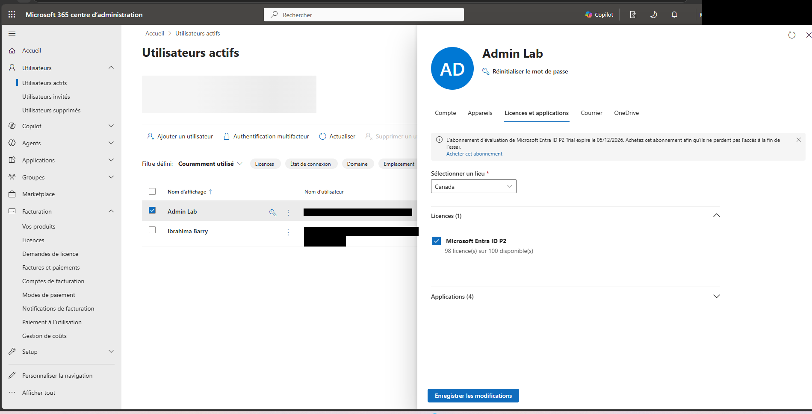

## 2. Le compte break-glass (accès d'urgence)

**Le réflexe de sécurité n°1 du lab.** Avant de créer la moindre politique d'accès conditionnel qui exige le MFA pour tout le monde, il faut un **filet** : si la configuration casse (ou si le MFA tombe), on peut se **verrouiller hors de son propre tenant**.

La parade : un **compte d'accès d'urgence** (`break-glass`) :
- Cloud-only, **Administrateur général**, mot de passe long stocké en lieu sûr
- **Exclu de TOUTES les politiques d'accès conditionnel**
- **Pas de MFA dépendant** (en entreprise : clés FIDO dédiées, souvent 2 comptes)

Ainsi, même si une règle bloque tout le monde, ce compte passe toujours et peut tout réparer. **Ce compte est exclu de CA01, CA02, CA03 et CA04.**

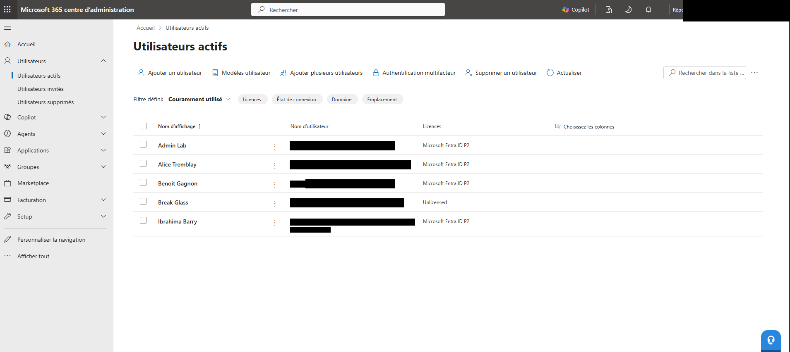

## 3. Accès conditionnel — protection statique

Les comptes de test sont regroupés dans un groupe de sécurité `SG-Employes` (Alice + Benoit), pour un ciblage plus propre en entreprise.

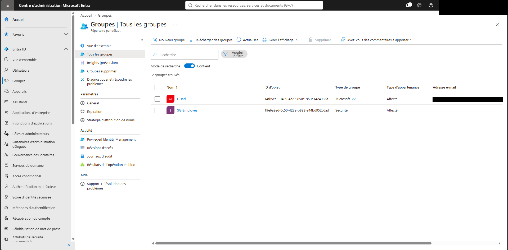

### CA01 — Exiger le MFA pour tous les utilisateurs
- **Cible :** tous les utilisateurs, **sauf Break Glass**
- **Ressources :** toutes
- **Contrôle :** exiger l'authentification multifacteur

**Méthode prudente (à retenir) :** politique créée d'abord en **« Rapport seul »** — elle *évalue* sans *appliquer*. Validation avec l'outil **« What If »** (simulation sur Alice → la politique s'appliquerait bien, MFA requis), **sans aucun risque de verrouillage**.

**Security Defaults :** le tenant avait les **paramètres de sécurité par défaut** activés (protection MFA « tout ou rien »). Ils sont **incompatibles** avec l'accès conditionnel. Il faut donc les **désactiver** pour laisser la main aux politiques CA (la version fine et pilotée). Fait, puis CA01 passée de « Rapport seul » à **Activé**.

**Test réel :** connexion d'Alice (navigation privée) → changement de mot de passe (1ʳᵉ connexion) → **enregistrement MFA forcé par CA01** (Microsoft Authenticator) → connexion réussie. La politique **fonctionne en production**.

> Choix important : lors de la création, j'ai choisi **« mon compte sera affecté — continuer »** plutôt que d'exclure l'admin. Raison : **les admins DOIVENT avoir le MFA** (ce sont des cibles prioritaires). Le break-glass suffit comme filet ; exclure les admins en permanence serait une mauvaise pratique.

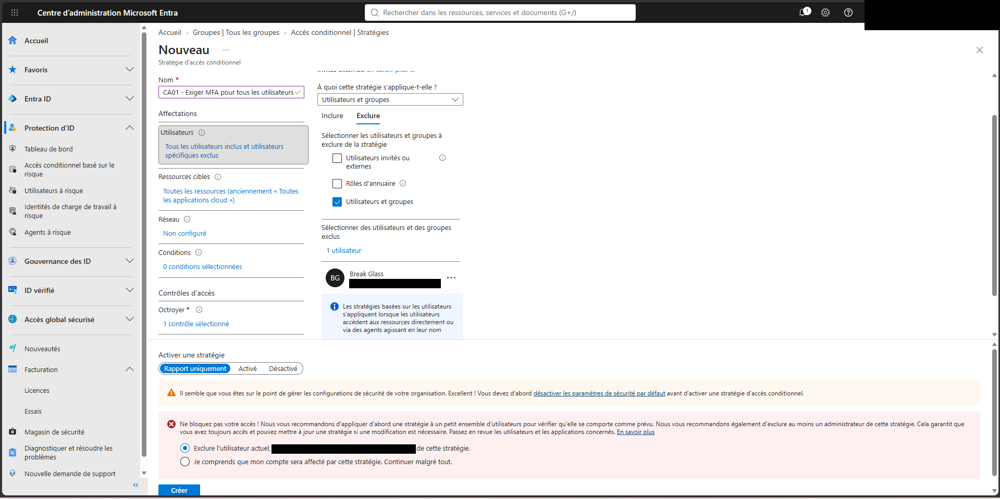
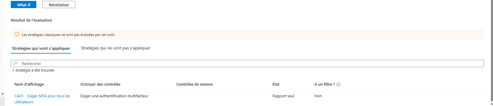
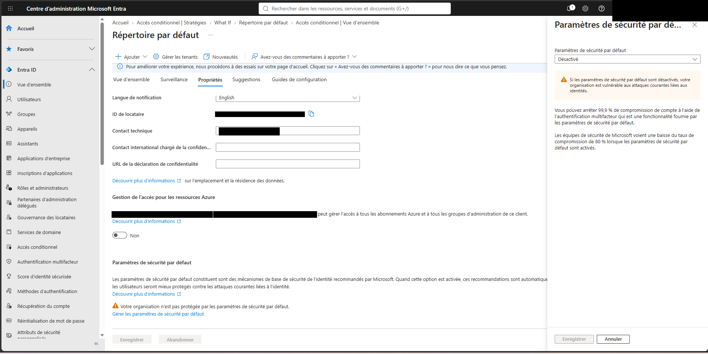
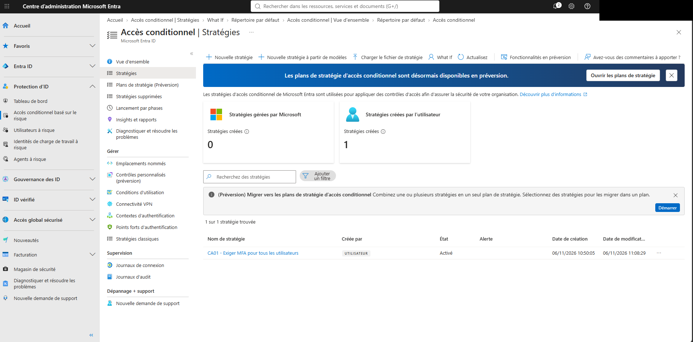
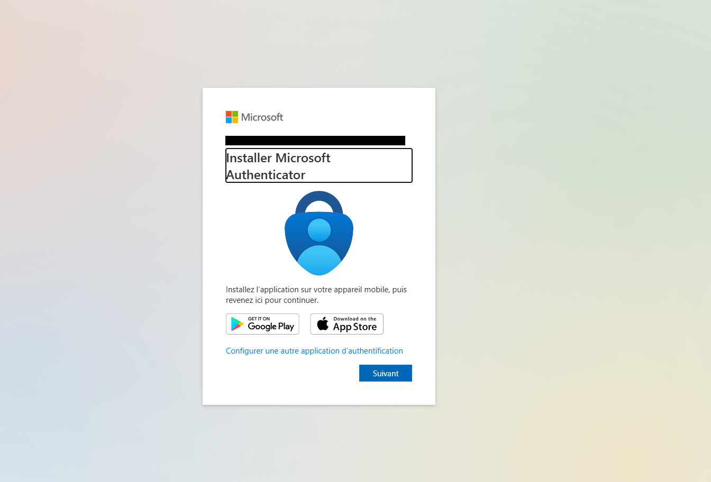
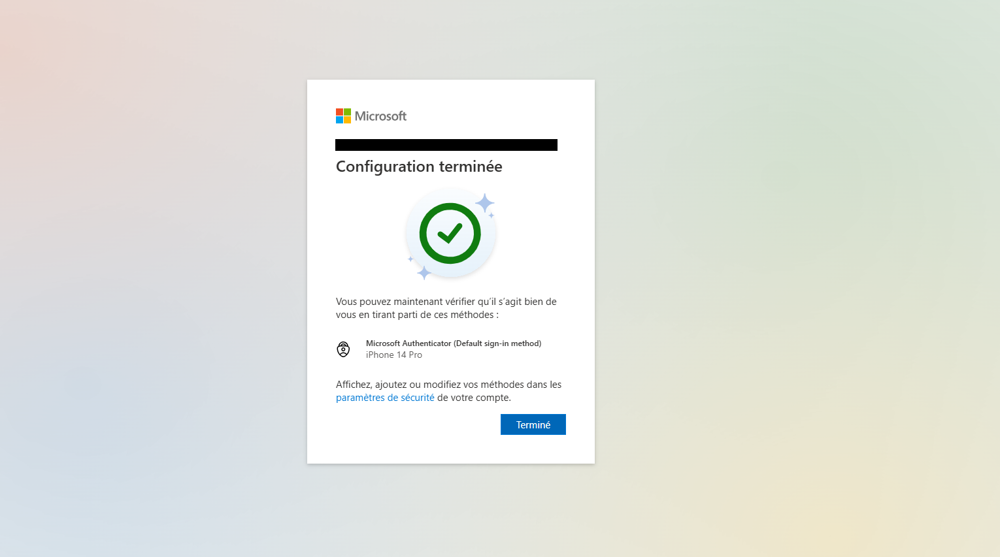

### CA02 — Bloquer l'authentification héritée
- **Cible :** tous les utilisateurs, **sauf Break Glass**
- **Condition → Applications clientes :** uniquement **Clients Exchange ActiveSync** + **Autres clients** (= auth héritée)
- **Contrôle :** **Bloquer l'accès**

**Pourquoi c'est essentiel :** les vieux protocoles (POP, IMAP, SMTP de base…) **ne supportent pas le MFA**. Un attaquant les utilise pour **contourner** la politique MFA. Les bloquer ferme cette porte dérobée.

> **CA01 + CA02 = la base.** CA01 exige le MFA sur l'auth moderne ; CA02 condamne l'auth héritée qui ne peut pas faire de MFA. Porte d'entrée verrouillée **et** porte de service condamnée.

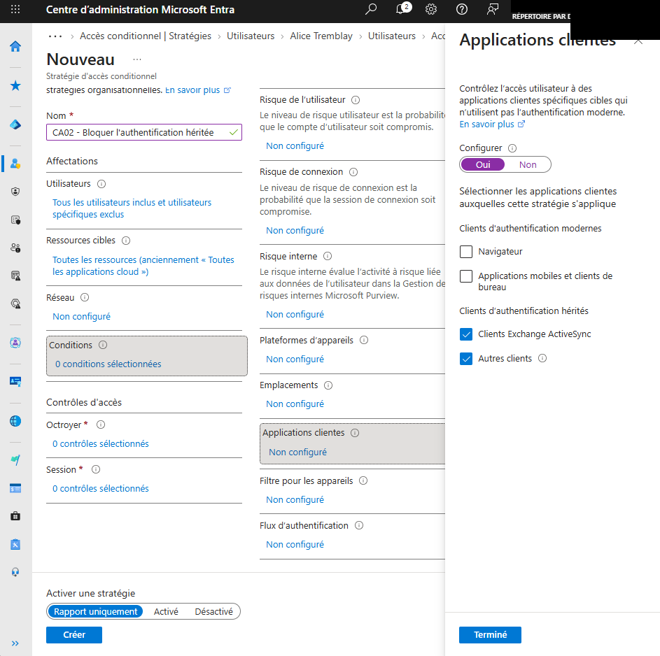
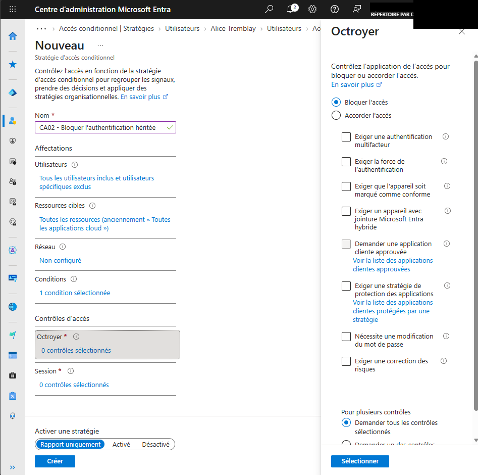

## 4. Identity Protection — protection dynamique

Jusqu'ici, les règles sont **statiques**. Identity Protection ajoute une couche **dynamique** : l'**IA de Microsoft** (des milliards de signaux/jour) attribue un **niveau de risque** à chaque connexion et à chaque compte.

| Type de risque | Attribué à… | Question |
|---|---|---|
| **Risque de connexion** | chaque connexion (événement) | « Cette connexion-ci est-elle légitime ? » |
| **Risque utilisateur** | le compte (cumulé) | « Ce compte est-il probablement compromis ? » |

Exemples de signaux : IP anonyme (Tor), **voyage impossible**, IP liée à un malware, **identifiants trouvés dans une fuite** (dark web), pulvérisation de mots de passe.

**Partage des rôles clé (point d'entrevue) :** **c'est Microsoft qui calcule et attribue le niveau** (Faible/Moyen/Élevé). **Nous, on fixe seulement le seuil de réaction.** Analogie : Microsoft est le détecteur de fumée qui *mesure* ; nous réglons *à partir de quel niveau on déclenche l'alarme*.

Les 3 rapports (Utilisateurs à risque, Connexions à risque, Détections de risques) étaient **vides** → tenant sain. C'est le **radar** de l'identité.

### CA03 — Connexion à risque élevé → exiger MFA
- **Condition → Risque de connexion :** Élevé + Moyen
- **Contrôle :** exiger le MFA
- Connexion normale → rien ; connexion jugée risquée → **MFA supplémentaire automatique**

### CA04 — Utilisateur à risque élevé → changement de mot de passe
- **Condition → Risque utilisateur :** Élevé
- **Contrôles :** **exiger un changement de mot de passe** (+ MFA imposé automatiquement par Entra)
- Compte jugé compromis → l'utilisateur doit **reprendre le contrôle** via un nouveau mot de passe (après MFA)

**Résultat : 4 politiques actives** — 2 statiques (CA01, CA02) + 2 dynamiques (CA03, CA04). Une architecture de sécurité d'identité complète.

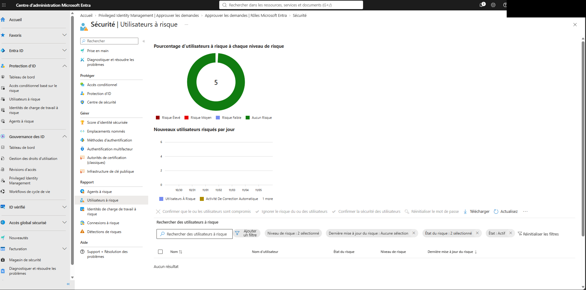
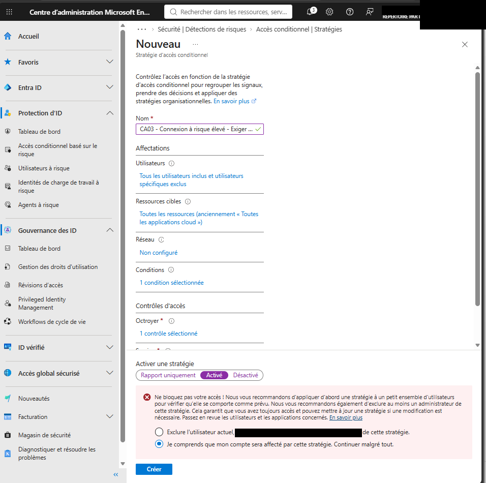
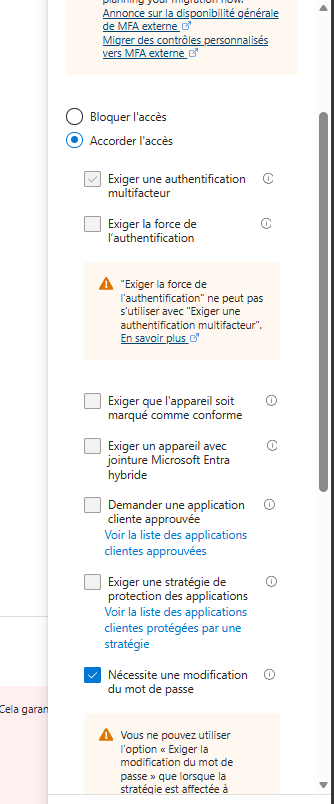
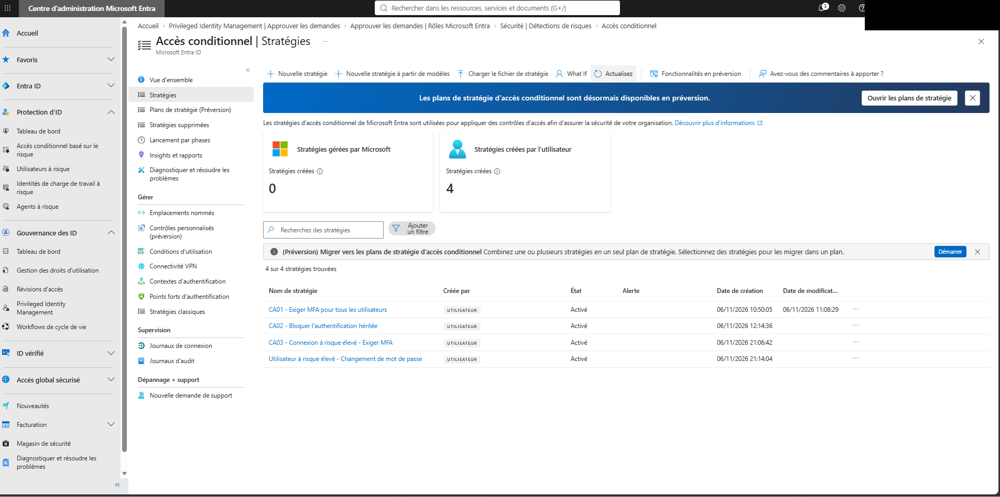

## 5. PIM — accès privilégié juste-à-temps

**Le principe :** au lieu d'un rôle admin **permanent** (une cible permanente pour un attaquant), on rend l'utilisateur **éligible**. Il n'a le rôle **que quand il en a besoin**, pour un **temps limité**, avec **justification** (et ici **approbation** + MFA). C'est le **moindre privilège dans le temps**.

**Mise en place :**
- Alice rendue **éligible** (pas active) au rôle **Administrateur d'utilisateurs**
- **Paramètres d'activation du rôle :**
  - Durée max : **1 heure**
  - **Azure MFA** exigé à l'activation
  - **Justification** obligatoire
  - **Approbation** requise → approbateur : le compte admin (séparation des tâches)

**Cycle complet testé (de bout en bout) :**
1. Alice (éligible) → **demande** l'activation → MFA + justification
2. Statut **« En attente d'approbation »** → Alice **n'est pas encore admin**
3. L'admin **approuve** avec justification (séparation des tâches : demandeur ≠ approbateur)
4. Le rôle d'Alice devient **actif 1 heure**, puis **expire automatiquement**

> **Lien avec le lab 4 :** c'est la **2ᵉ fois** que le juste-à-temps apparaît. Lab 4 : JIT appliqué au **réseau** (port RDP ouvert à la demande). Lab 5 : JIT appliqué à l'**identité** (rôle admin activé à la demande). Même principe, deux couches : « fermé/inactif par défaut → ouvert/actif à la demande, justifié, limité dans le temps → refermé automatiquement ».

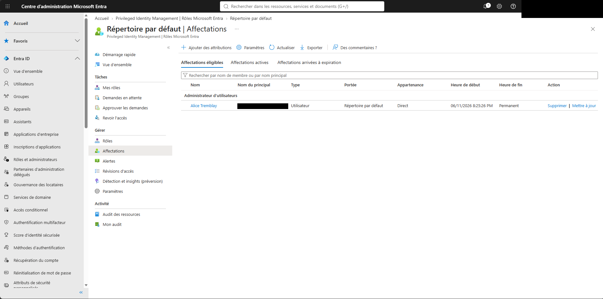
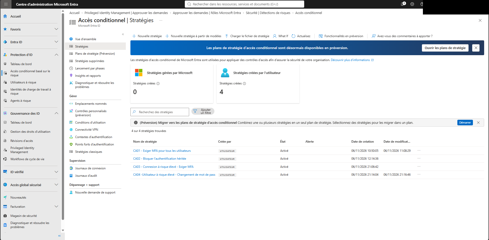
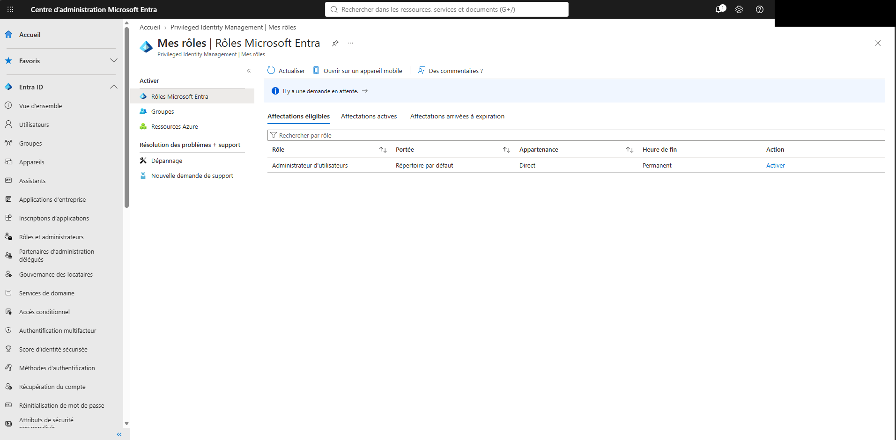
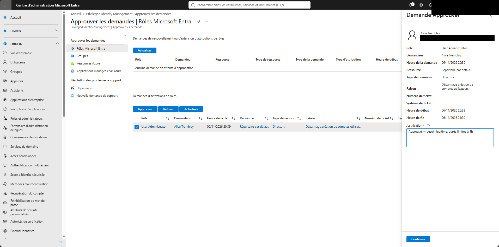
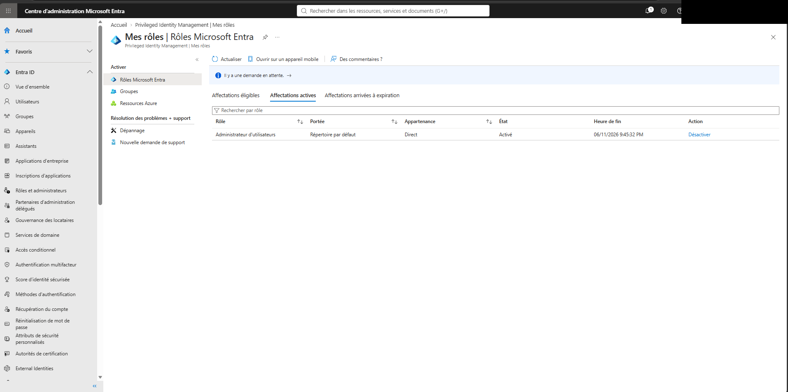

## 6. Revue d'accès — gouvernance dans le temps

Les accès **s'accumulent** (changements d'équipe, départs, stages finis…) et personne ne les retire → **dérive des privilèges**. La **revue d'accès** est un contrôle **périodique** où un responsable **recertifie** que les bonnes personnes ont encore les bons accès.

**Mise en place :** revue **trimestrielle** des personnes **éligibles** au rôle **Administrateur d'utilisateurs**.
- **Réviseur :** le compte admin
- **Appliquer automatiquement les résultats** : activé (un « refuser » retire l'accès automatiquement)
- **Si pas de réponse :** aucune modification (prudent)
- **Justification** obligatoire + **recommandations** affichées

**La revue réalisée :** Entra **recommandait « Refuser »** pour Alice (raison : *dernière connexion > 30 jours*). J'ai choisi d'**approuver** avec justification (rôle encore nécessaire).

> **Point clé (entrevue) :** **la machine recommande, l'humain tranche.** Entra ne retire jamais seul — il propose une recommandation basée sur les données, mais le **réviseur reste responsable** de la décision finale. Tout est **tracé** (qui, quoi, quand, pourquoi) → piste d'audit pour la conformité.

**Outil voisin à connaître :** pour **désactiver automatiquement un compte** quand une personne part (offboarding), ce n'est **pas** la revue d'accès mais les **Workflows de cycle de vie** (*Lifecycle Workflows*, Entra ID Governance) — workflow « leaver » déclenché par la date de départ. La revue d'accès retire des **accès** ; elle ne supprime pas le **compte**.

---

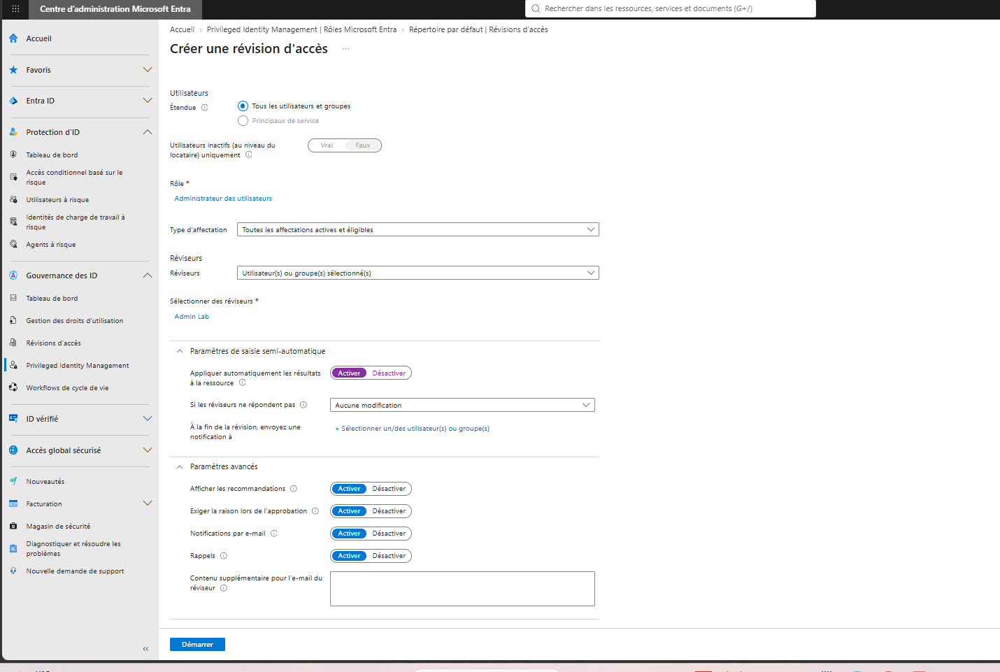
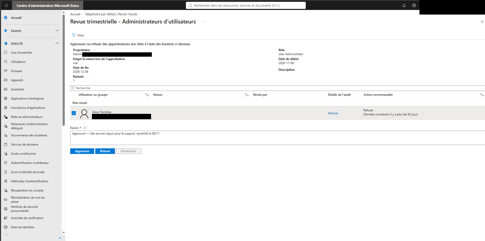
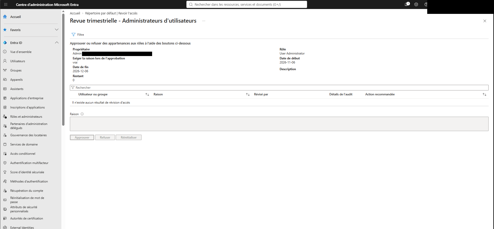

## Security Defaults vs Accès conditionnel (synthèse)

| | Security Defaults | Accès conditionnel |
|---|---|---|
| Public | Petits tenants | Toute organisation voulant du contrôle |
| Granularité | Tout ou rien | Fine (par utilisateur, risque, appareil, lieu…) |
| Licence | Gratuit | P1 / P2 |
| Compatibilité | **Incompatibles entre eux** — l'un OU l'autre | |

## Ce que j'ai appris
- **L'identité est le périmètre** : MFA, auth héritée, risque, privilèges et gouvernance forment une défense en profondeur.
- **Break-glass d'abord** : on ne touche jamais à l'accès conditionnel sans compte d'urgence exclu.
- **Rapport seul + What If** : on valide une politique **avant** de l'appliquer — zéro verrouillage.
- **Statique + dynamique** : règles fixes (MFA, auth héritée) **et** réaction au risque en temps réel (Identity Protection).
- **PIM = moindre privilège dans le temps** : éligible ≠ actif ; demande → MFA → justification → approbation → 1h → expiration.
- **Gouvernance** : la revue d'accès recertifie ; la machine recommande, l'humain décide ; tout est audité.
- **JIT transversal** : même principe au réseau (lab 4) et à l'identité (lab 5).

## Nettoyage
- L'essai **Entra ID P2** se termine le **5 décembre 2026** ; un rappel est programmé pour l'annuler et éviter toute facturation.
- Tenant de test dédié, destiné à être supprimé après le lab.

## Avertissement
Laboratoire personnel réalisé dans mon propre tenant de test Microsoft Entra ID, à des fins d'apprentissage (SC-300). Les identifiants de locataire, adresses courriel et autres données sensibles ont été **masqués** dans les captures. Les utilisateurs « Alice Tremblay » et « Benoit Gagnon » sont **fictifs**, créés pour le lab.
